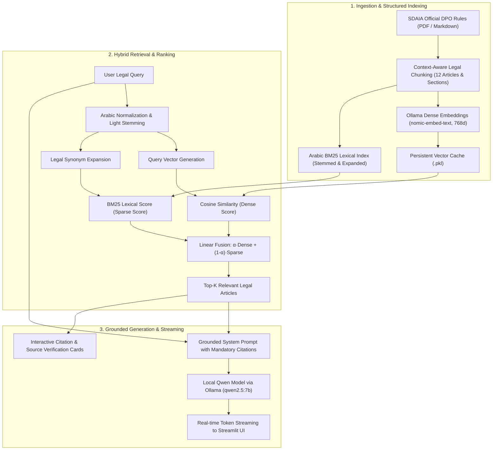

# 🛡️ SDAIA DPO Advisor | Local Hybrid RAG System
### Intelligent Regulatory Advisory System for the Rules of Appointing a Personal Data Protection Officer (DPO)

<p align="center">
  
  
  
  
  
  
  
  
</p>

---

## 🎓 Academic & Training Program Context

This project was engineered and delivered as an applied capstone project within:
> **Generative AI Solutions Development Program**  
> *(برنامج تطوير حلول الذكاء الاصطناعي التوليدي)*  
> Organized and presented by **[SDAIA Academy](https://github.com/SDAIAAcademy)** — Saudi Data & AI Authority.

---

## 👥 Project Team — Group 5 (فريق العمل - المجموعة 5)

This project was designed, developed, and delivered by **Group 5**:

- 🌟 **Abdullah Alotaibi**
- 🌟 **Afnan Alharbi**
- 🌟 **Leena Aljuwaysir**
- 🌟 **Aljawharah Almutairi**
- 🌟 **Majed Alsehli**
- 🌟 **Raid Almousa**

---

## 📖 Project Overview

**SDAIA DPO Advisor** is an end-to-end interactive AI advisory web application powered by **Retrieval-Augmented Generation (RAG)**. It is built specifically for querying, understanding, and complying with the official regulatory document:  
**«Rules for Appointing a Personal Data Protection Officer (DPO)»** *(قواعد تعيين مسؤول حماية البيانات الشخصية)*  
issued by the **Saudi Data & AI Authority (SDAIA)**, Version **1.0 (August 2024)**, pursuant to Article 30(2) of the Saudi Personal Data Protection Law (Royal Decree No. M/19, amended by Royal Decree No. M/148) and Article 32(4) of its Executive Regulations.

The application operates **100% locally on-premise**, ensuring zero data leakage and maximum data sovereignty by orchestrating a locally hosted **Qwen LLM** via **Ollama** alongside the dense embedding model **`nomic-embed-text`**.

---

## ✨ Key Features

1. **Precision Hybrid Retrieval (Dense Vector + Arabic BM25):**
   - **Dense Semantic Embeddings:** Uses `nomic-embed-text` (768 dimensions) to calculate cosine similarity across legal sections.
   - **Arabic-Aware BM25 Lexical Engine:** Custom-engineered lexical retriever featuring an Arabic light stemmer (affix removal for `الـ`, `للـ`, `و`, `ف`, `ب`, `ك`), stopword filtration, and a legal synonym expansion dictionary (e.g., matching *حالات $\leftrightarrow$ أحوال*, *شروط $\leftrightarrow$ متطلبات*, *مهام $\leftrightarrow$ أدوار*, *إبلاغ $\leftrightarrow$ تزويد / منصة*).
   - **Score Fusion:** Convex combination of dense and sparse scores with customizable $\alpha$ weights.

2. **Legal Transparency & Verified Citations:**
   - Every answer is accompanied by interactive citation cards displaying:
     - Exact Article Number and Title (e.g., *Article 5: Cases of Mandatory Appointment*).
     - Original Page Number in SDAIA's official release.
     - Semantic Relevance Match Percentage.
     - Verbatim excerpt from the regulatory text.

3. **100% Local Inference & Total Privacy:**
   - Powered by local **Qwen** models (`qwen2.5:7b` default, `qwen3.5:4b`, `qwen2.5:14b`, `qwen2.5:1.5b`) through Ollama.
   - Zero external API dependencies, zero external network queries, and complete compliance with personal data residency regulations.

4. **Modern, Responsive Streamlit Interface:**
   - Bilingual-ready RTL Arabic typography styled with SDAIA's official visual identity (Emerald `#00A389`, Deep Navy `#091E3A`, and Gold accents).
   - **Quick Question Chips:** Instant 1-click test questions for common regulatory queries.
   - **Live Token Streaming:** Answers stream token-by-token directly into the chat bubble.
   - **Official Document Reader:** Search, filter, and read all 11 articles with a download button for the full Markdown document.
   - **RAG Inspector & Lab:** Live diagnostic view showing similarity scores, ranking comparisons, and chunk statistics.
   - **Custom Document Uploader:** Support for uploading external PDFs to augment or compare knowledge bases.

---

## 🏛️ System Architecture & Workflow



> 📘 For comprehensive technical formulas, chunking rationale, prompt templates, and evaluation, refer to the [Technical Documentation](docs/TECHNICAL_DOCUMENTATION.md).

---

## 📂 Repository Structure

```text
SDAIA-DPO-Rules-RAG/
├── app.py                         # Main Streamlit web application & UI
├── rag_engine.py                  # Hybrid RAG engine, BM25 retriever & Ollama client
├── requirements.txt               # Python package dependencies
├── LICENSE                        # MIT Open-Source License
├── README.md                      # Project documentation (English)
├── docs/
│   └── TECHNICAL_DOCUMENTATION.md # In-depth technical architecture & math specification
└── data/
    ├── sdaia_dpo_rules.json       # Parsed & structured regulatory articles with metadata
    ├── sdaia_dpo_rules.md         # Full official regulation text in Markdown
    └── cache/                     # Pre-computed embeddings cache for instant startup
```

---

## ⚙️ Prerequisites

1. **Python 3.10 or higher**
2. **Ollama**:
   - Download and install Ollama from [https://ollama.ai](https://ollama.ai)
   - Ensure the Ollama background daemon is running:
     ```bash
     ollama serve
     ```
   - Pull the required models:
     ```bash
     ollama pull qwen2.5:7b
     ollama pull nomic-embed-text
     ```

---

## 🚀 Quick Start Guide

### 1. Clone the Repository
```bash
git clone https://github.com/vabdull/SDAIA-DPO-Rules-RAG.git
cd SDAIA-DPO-Rules-RAG
```

### 2. Install Python Dependencies
```bash
pip install -r requirements.txt
```

### 3. Launch the Application
```bash
streamlit run app.py
```

The application will automatically open in your default browser at:  
👉 **`http://localhost:8501`**

---

## 💡 Example Queries for Testing

You can ask any question in Arabic or English. Here are verified test questions supported out of the box:

- **Mandatory Appointment Conditions:**  
  *«ما هي الحالات التي يجب فيها على جهة التحكم تعيين مسؤول حماية البيانات الشخصية؟»*  
  *(When is a controller legally required to appoint a DPO?)*
- **Qualifications & Requirements:**  
  *«ما هي الشروط والمتطلبات الواجب توافرها في مسؤول حماية البيانات وفقاً للمادة الرابعة؟»*  
  *(What qualifications and integrity criteria must a DPO meet under Article 4?)*
- **Large-Scale Processing Criteria:**  
  *«ما هي المعايير المعتمدة لتحديد ما إذا كانت المعالجة على نطاق واسع؟»*  
  *(What criteria define large-scale personal data processing under Article 5?)*
- **DPO Duties & Core Tasks:**  
  *«ما هي أدوار ومهام مسؤول حماية البيانات الشخصية وفقاً للمادة الثامنة؟»*  
  *(What are the official roles and tasks of the DPO under Article 8?)*
- **Regular & Systematic Monitoring:**  
  *«اذكر أمثلة على المراقبة المنتظمة والممنهجة لأصحاب البيانات الشخصية.»*  
  *(Provide examples of regular and systematic monitoring as defined in the regulation.)*
- **National Platform Notification:**  
  *«كيف يتم توثيق التعيين وإبلاغ الهيئة وما هي المنصة المحددة لتزويد بيانات التواصل؟»*  
  *(How is the appointment documented and submitted via the National Data Governance Platform?)*

---

## 🤝 Acknowledgments
Special thanks and appreciation to:
- **[SDAIA Academy](https://github.com/SDAIAAcademy)** and the instructional team of the **Generative AI Solutions Development Program** for their invaluable guidance, curriculum, and academic leadership.
- The members of **Group 5** (*Abdullah Alotaibi, Afnan Alharbi, Leena Aljuwaysir, Aljawharah Almutairi, Majed Alsehli, Raid Almousa*) for their teamwork, dedication, and collaborative engineering.
- The **Saudi Data & AI Authority (SDAIA)** for establishing national regulatory frameworks and empowering the AI ecosystem across the Kingdom.
- The open-source teams behind **Streamlit**, **Ollama**, and **Qwen** for their cutting-edge tools and models.

---

## 📄 License
This project is licensed under the **MIT License** — see the [LICENSE](LICENSE) file for details.
