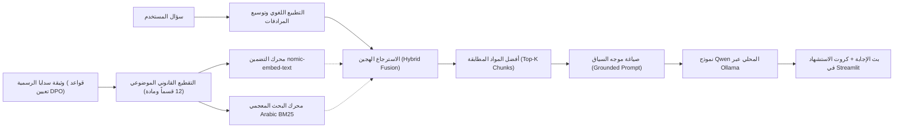

# 🛡️ المستشار الذكي لقواعد تعيين مسؤول حماية البيانات الشخصية
### SDAIA DPO Advisor | Local Hybrid RAG System

<p align="center">
  
  
  
  
  
  
</p>

---

## 🎓 البرنامج التدريبي والسياق الأكاديمي
تم تنفيذ وتطوير هذا المشروع كمشروع تطبيقي متميز ضمن:
> **برنامج تطوير حلول الذكاء الاصطناعي التوليدي (Generative AI Solutions Development)**  
> المقدم من **[أكاديمية سدايا (SDAIA Academy)](https://github.com/SDAIAAcademy)** - الهيئة السعودية للبيانات والذكاء الاصطناعي.

---

## 📖 فكرة ووصف المشروع (Project Overview)

تطبيق ويب تفاعلي واستشاري ذكي يعتمد على تقنية **الاسترجاع المعزز بالتوليد (RAG - Retrieval-Augmented Generation)** لتمكين الجهات والمسؤولين والباحثين من الاستفسار الذكي والفوري حول وثيقة:  
**«قواعد تعيين مسؤول حماية البيانات الشخصية»**  
الصادرة رسمياً عن **الهيئة السعودية للبيانات والذكاء الاصطناعي (سدايا)** برقم الإصدار **1.0 (أغسطس 2024م)** والمستندة إلى **نظام حماية البيانات الشخصية (المرسوم الملكي م/19 وتعديلاته بالمرسوم الملكي م/148)** ولائحته التنفيذية.

يعمل النظام **محلياً بالكامل (100% Local Inference)** على أجهزة المستخدمين دون الاعتماد على أي خدمات سحابية خارجية، محققاً أقصى درجات سرية وأمان البيانات، بالاعتماد على نموذج **Qwen (عبر خادم Ollama)** ونموذج التضمين المتجهي **nomic-embed-text**.

---

## ✨ المميزات الرئيسية (Key Features)

1. **محرك استرجاع هجين فائق الدقة (Hybrid Retrieval: Vector + BM25):**
   - **بحث دلالي (Semantic Search):** توليد متجهات التضمين بنموذج `nomic-embed-text` (768 بُعداً) مع قياس تشابه جيب التمام (Cosine Similarity).
   - **بحث معجمي ذكي (BM25 Lexical Matching):** مزود بمجرد صرفي للغة العربية (Light Stemmer) وإزالة الكلمات الزائدة وتوسيع تلقائي للمرادفات القانونية (مثل: *حالات/أحوال*، *شروط/متطلبات*، *مهام/أدوار*، *إبلاغ/تزويد/منصة*).
   - تحكم كامل بنسبة الدمج ($\alpha$) وعدد المواد المسترجعة ($Top\text{-}K$).

2. **التوثيق والشفافية القانونية (Source Transparency & Citations):**
   - يرفق النظام مع كل إجابة كروت استشهاد تفاعلية تبين: **رقم المادة القانونية، رقم الصفحة في الوثيقة الأصلية، ونسبة التطابق**، مع النص الأصلي المقتبس.

3. **ذكاء محلي وحماية تامة للخصوصية:**
   - يعمل على نماذج **Qwen** المحلية (`qwen2.5:7b` الافتراضي، `qwen3.5:4b`، `qwen2.5:14b`، `qwen2.5:1.5b`) عبر خادم Ollama.
   - لا تتطلب المعالجة أو الاستعلام إرسال أي بايت إلى خوادم خارجية.

4. **واجهة استخدام عصرية ومبتكرة (Streamlit UI):**
   - تصميم عربي أنيق باتجاه اليمين لليسار (RTL) بهوية بصرية مستوحاة من ألوان سدايا (الأخضر الزمردي والكحلي الملكي).
   - أسئلة مقترحة سريعة للاختبار بنقرة واحدة (Quick Question Chips).
   - بث مباشر للإجابات كلمة بكلمة (Token Streaming).
   - **متصفح نصوص الوثيقة:** لقراءة المواد والبحث بداخلها وتنزيل الوثيقة بصيغة Markdown.
   - **مختبر الاسترجاع (RAG Inspector):** لتجربة وفحص درجات المطابقة الدلالية وترتيب القطع حسب السؤال.
   - إمكانية رفع وتجربة مستندات PDF مخصصة مع خيار العودة الفورية لوثيقة سدايا الأصلية.

---

## 🏛️ المعمارية الفنية وسير العمل (System Architecture)



> 📘 للاطلاع على التفاصيل الرياضية والمعمارية وهندسة الأوامر واستراتيجيات التقطيع، يُرجى مراجعة [ملف التوثيق الفني الكامل](docs/TECHNICAL_DOCUMENTATION.md).

---

## 📂 هيكلية ملفات المشروع (Repository Structure)

```text
├── app.py                         # التطبيق الرئيسي وواجهة المستخدم (Streamlit App)
├── rag_engine.py                  # محرك RAG والبحث الهجين والربط مع Ollama
├── requirements.txt               # الاعتماديات والمكتبات البرمجية
├── LICENSE                        # رخصة المشروع (MIT License)
├── README.md                      # التوثيق التعريفي للمشروع
├── docs/
│   └── TECHNICAL_DOCUMENTATION.md # التوثيق الفني المعمق للنظام
└── data/
    ├── sdaia_dpo_rules.json       # نصوص الوثيقة مقسمة ومفهرسة مع بيانات الصفحات
    ├── sdaia_dpo_rules.md         # نص الوثيقة الرسمي الكامل بصيغة Markdown
    └── cache/                     # التخزين المؤقت للمتجهات (Fast Startup Cache)
```

---

## ⚙️ متطلبات التشغيل (Prerequisites)

1. **بايثون (Python 3.10+):**
   تأكد من تثبيت بايثون على جهازك.

2. **تثبيت وتشغيل Ollama:**
   - حمّل وثبّت Ollama من الموقع الرسمي: [https://ollama.ai](https://ollama.ai)
   - تأكد من تشغيل خادم Ollama:
     ```bash
     ollama serve
     ```
   - اسحب نموذج التوليد ونموذج التضمين:
     ```bash
     ollama pull qwen2.5:7b
     ollama pull nomic-embed-text
     ```

---

## 🚀 طريقة التثبيت والتشغيل (Quick Start)

### 1. استنساخ المستودع (Clone Repository)
```bash
git clone https://github.com/vabdull/SDAIA-DPO-Rules-RAG.git
cd SDAIA-DPO-Rules-RAG
```

### 2. تثبيت الحزم المطلوبة (Install Dependencies)
```bash
pip install -r requirements.txt
```

### 3. تشغيل التطبيق (Run Streamlit)
```bash
streamlit run app.py
```

سيفتح التطبيق تلقائياً في متصفحك على الرابط:  
🌐 **`http://localhost:8501`**

---

## 💡 نماذج من الأسئلة المدعومة للاختبار

- **حالات التعيين الإلزامي:** "ما هي الحالات التي يلزم فيها على جهة التحكم تعيين مسؤول حماية البيانات الشخصية؟"
- **شروط ومؤهلات المسؤول:** "ما هي المتطلبات الواجب توافرها في مسؤول حماية البيانات وفقاً للمادة الرابعة؟"
- **معايير المعالجة على نطاق واسع:** "كيف يتم تحديد ما إذا كانت المعالجة تتم على نطاق واسع؟"
- **أدوار ومهام المسؤول:** "ما هي مهام ومسؤوليات مسؤول حماية البيانات الشخصية وفقاً للمادة الثامنة؟"
- **أمثلة المراقبة المنتظمة والممنهجة:** "اذكر أمثلة على عمليات المراقبة المنتظمة والممنهجة الواردة في المادة الخامسة."
- **التوثيق وإبلاغ الهيئة:** "كيف يتم توثيق تعيين المسؤول وما هي المنصة المحددة لتزويد الهيئة ببيانات التواصل؟"

---

## 🤝 شكر وتقدير (Acknowledgments)

يتقدم مطور المشروع بخالص الشكر والتقدير إلى:
- **[أكاديمية سدايا (SDAIA Academy)](https://github.com/SDAIAAcademy)** والقائمين على **برنامج تطوير حلول الذكاء الاصطناعي التوليدي** على الإشراف والدعم المعرفي المتميز.
- الهيئة السعودية للبيانات والذكاء الاصطناعي (**سدايا**) على جهودها الرائدة في بناء الأطر التنظيمية للبيانات الوطنية.
- مجتمعات المصدر المفتوح لكل من **Streamlit** و **Ollama** و **Qwen Team** على إتاحة هذه النماذج والأدوات المتطورة.

---

## 📄 الترخيص (License)
هذا المشروع مرخص تحت رخصة **MIT** - راجع ملف [LICENSE](LICENSE) لمزيد من التفاصيل.
