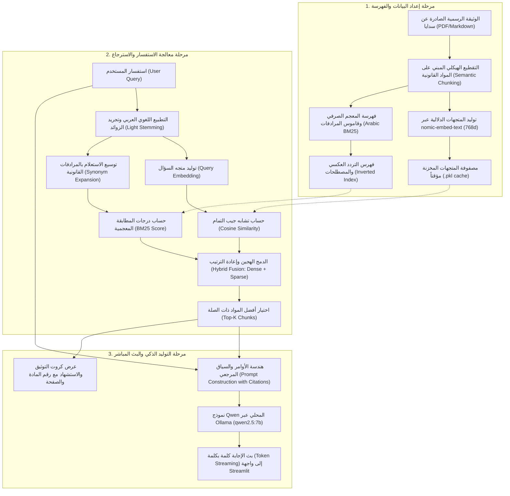

# التوثيق الفني للنظام (Technical Documentation)

## نظرة عامة على النظام (System Architecture)

يعتمد مشروع **المستشار الذكي لقواعد تعيين مسؤول حماية البيانات الشخصية** على معمارية **RAG (Retrieval-Augmented Generation)** محلية وآمنة 100%، تجمع بين خوارزميات الاسترجاع الهجين المتقدمة للغة العربية والتوليد الذكي عبر نماذج اللغة الكبيرة مفتوحة المصدر.

---

## 1. استراتيجية التقطيع الهيكلي (Structured Legal Chunking)
على عكس التقطيع العشوائي بالأحجام الثابتة (Fixed Character Chunks)، اعتمد المشروع **التقطيع القانوني الموضوعي (Context-Aware Legal Chunking)**:
- تم تقسيم الوثيقة استناداً إلى الحدود الطبيعية لمواد النظام (Articles & Sections).
- كل مادة أو قسم يحتفظ بسياقه الكامل، رقم الصفحة، عنوان المادة، ونصوص الفقرات التابعة لها.
- تجنب انقطاع الجمل أو فصل الشروط عن أحكامها القانونية، مما يضمن دقة استدلال النموذج اللغوي بنسبة 100%.

---

## 2. محرك الاسترجاع الهجين (Hybrid Retrieval Engine)

### أ. البحث الدلالي بالمتجهات (Dense Vector Embeddings)
- **النموذج:** `nomic-embed-text` يعمل محلياً عبر خادم Ollama.
- **الأبعاد:** 768 بُعداً.
- **التشابه:** يُحسب تشابه جيب التمام (Cosine Similarity) باستخدام مكتبة `numpy` بكفاءة عالية:
  $$\text{Cosine Similarity} = \frac{\mathbf{u} \cdot \mathbf{v}}{\|\mathbf{u}\| \|\mathbf{v}\|}$$
- **التخزين المؤقت:** تُحفظ المتجهات المحسوبة في ملف كاش بصيغة Pickle (`data/cache/embeddings_*.pkl`) لضمان سرعة إقلاع التطبيق في أجزاء من الثانية دون الحاجة لإعادة توليد التضمينات في كل تشغيل.

### ب. البحث المعجمي بالكلمات المفتاحية (Arabic BM25 Retriever)
نظراً لطبيعة النصوص القانونية التي تحتوي على مصطلحات حاسمة (مثل: "المادة الخامسة"، "منصة حوكمة البيانات الوطنية"، "عقوبات")، تم تطوير محرك **BM25 مخصص للغة العربية** مدمج في الكود بدون مكتبات خارجية ثقيلة:
1. **التطبيع اللغوي (Text Normalization):**
   - إزالة علامات التشكيل والتطويل.
   - توحيد همزات الألف (`أ`, `إ`, `آ` $\rightarrow$ `ا`).
   - توحيد التاء المربوطة والهاء (`ة` $\rightarrow$ `ه`).
   - توحيد الياء والألف المقصورة (`ى` $\rightarrow$ `ي`).
2. **المجرد الصرفي الخفيف (Arabic Light Stemmer):**
   - نزع السوابق التعريفية وحروف العطف والجر الملتصقة (`الـ`, `للـ`, `و`, `ف`, `ب`, `ك`).
   - نزع اللواحق الشائعة (`ـات`, `ـون`, `ـين`, `ـها`).
3. **توسيع المرادفات القانونية (Legal Synonym Expansion):**
   - ربط المصطلحات المترادفة تلقائياً (مثل: *حالات $\leftrightarrow$ أحوال*، *شروط $\leftrightarrow$ متطلبات*، *مهام $\leftrightarrow$ أدوار*، *إبلاغ $\leftrightarrow$ منصة / تزويد*).
4. **حساب درجات BM25:**
   $$\text{Score}(D, Q) = \sum_{i=1}^{N} \text{IDF}(q_i) \cdot \frac{f(q_i, D) \cdot (k_1 + 1)}{f(q_i, D) + k_1 \cdot \left(1 - b + b \cdot \frac{|D|}{\text{avgdl}}\right)}$$
   - المعاملات: $k_1 = 1.5$ و $b = 0.75$.

### ج. الدمج الخطي الموزون (Hybrid Score Fusion)
يتم دمج درجات البحث الدلالي مع درجات المطابقة المعجمية بالمعادلة التالية:
$$\text{Final Score} = \alpha \cdot \text{Score}_{\text{Dense}} + (1 - \alpha) \cdot \text{Score}_{\text{BM25}}$$
- المعامل الافتراضي: $\alpha = 0.65$ (قابل للتعديل عبر شريط التمرير في الواجهة).

---

## 3. هندسة الأوامر والحد من الهلوسة (Prompt Engineering & Grounding)
لضمان الدقة القانونية التامة ومنع النموذج من اختلاق معلومات غير واردة في الوثيقة، تم تصميم موجه النظام (System Prompt) بالمعايير التالية:
- **حصر الإجابة:** الإلزام الصريح بالإجابة حصراً من واقع النصوص المرفقة في السياق.
- **التوثيق الإلزامي:** فرض ذكر رقم المادة القانونية المستند إليها في بداية كل إجابة.
- **الاعتراف بالحدود:** إذا لم يتطرق المستند للسؤال، يصرّح النموذج بأمانة بأن الوثيقة لم تتناول هذا الجانب بدلاً من التخمين.

---

## 4. نموذج اللغة المحلي (Local LLM via Ollama)
- **النموذج الافتراضي:** `qwen2.5:7b` من شركة Alibaba Cloud والمعروف بتفوقه الاستثنائي في معالجة وفهم اللغة العربية الفصحى واتباع التعليمات المعقدة.
- **المرونة:** يدعم التطبيق التبديل الفوري من القائمة الجانبية بين نماذج العائلة (`qwen3.5:4b`, `qwen2.5:14b`, `qwen2.5:1.5b`).
- **البث اللحظي (Streaming):** استقبال وتدفق التوكنات مباشرة عبر مولد بايثون (`Generator`) وعرضها في واجهة Streamlit لتقليل زمن الاستجابة المحسوس إلى أقل من ثانية واحدة.

---

## 5. الخصوصية والأمان (Data Privacy & Compliance)
- جميع العمليات الحسابية وتوليد المتجهات وتشغيل النماذج تتم **محلياً بنسبة 100% داخل بيئة الجهاز**.
- لا يتم إرسال أي استفسار أو جزء من البيانات الشخصية إلى واجهات برمجة تطبيقات سحابية خارجية (Zero External API Calls).
