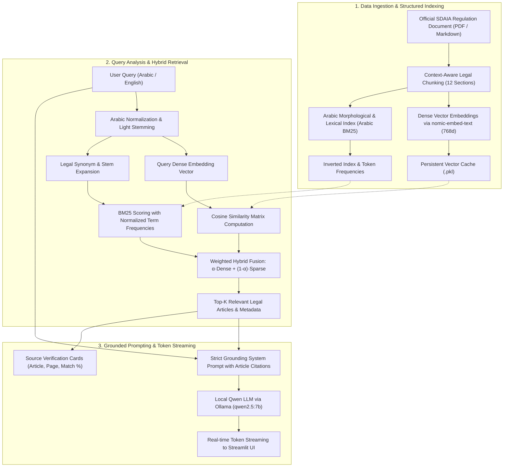

# Technical Documentation: SDAIA DPO Advisor RAG Engine

## 1. System Architecture Overview

The **SDAIA DPO Advisor** is an on-premise, secure **Retrieval-Augmented Generation (RAG)** pipeline designed to provide high-precision legal Q&A over the official Saudi regulation: *«Rules for Appointing a Personal Data Protection Officer (DPO)»*.

---

## 2. Ingestion & Structured Chunking Strategy

Conventional fixed-size character chunking often breaks legal provisions mid-sentence, detaching stipulations from their governing conditions. To eliminate this issue, we adopted **Context-Aware Legal Chunking**:

- The regulatory text is split strictly along legal boundaries (Articles and Section Headers).
- Each chunk preserves:
  - Unique identifier (`id`)
  - Canonical Article title (`title`, e.g., *«المادة الخامسة: أحوال تعيين مسؤول حماية البيانات الشخصية»*)
  - Associated document page number (`page`)
  - Full verbatim legal text (`content`)
- Chunks average 120–250 words, allowing complete legal context retention while fitting comfortably within the model's high-attention window.

---

## 3. Hybrid Retrieval Engine

Legal inquiries often combine conceptual questions (*"When do I need to appoint someone?"*) with strict statutory terms and numbers (*"Article 5"*, *"National Data Governance Platform"*, *"Sensitive Data"*). We combine dense semantic vectors with an Arabic-adapted BM25 lexical engine.

### A. Dense Vector Embeddings
- **Model:** `nomic-embed-text` hosted locally via Ollama.
- **Dimensionality:** 768 dimensions.
- **Metric:** Cosine Similarity computed using vectorized `NumPy`:
  $$\text{Cosine}(\mathbf{u}, \mathbf{v}) = \frac{\mathbf{u} \cdot \mathbf{v}}{\|\mathbf{u}\|_2 \cdot \|\mathbf{v}\|_2}$$
- **Caching Mechanism:** Pre-computed embeddings are serialized to `data/cache/embeddings_nomic-embed-text.pkl`. Subsequent application runs load the embeddings in `< 1ms`.

### B. Custom Arabic BM25 Lexical Engine
To address Arabic's rich morphology without heavy external dependencies, we implemented an in-engine Arabic BM25 retriever:
1. **Normalization:** Strips diacritics (*Tashkeel*), unifies *Alef* variants (`أ, إ, آ` $\rightarrow$ `ا`), *Taa Marbuta* (`ة` $\rightarrow$ `ه`), and *Alef Maqsura* (`ى` $\rightarrow$ `ي`).
2. **Light Stemming:** Removes proclitics and prefixes (`الـ`, `للـ`, `و`, `ف`, `ب`, `ك`) and suffixes (`ـات`, `ـون`, `ـين`, `ـها`).
3. **Legal Synonym Expansion:** Automatically injects statutory synonyms into query tokens:
   - *حالات (Cases) $\longleftrightarrow$ أحوال (Circumstances)*
   - *شروط (Conditions) $\longleftrightarrow$ متطلبات (Requirements)*
   - *واجبات (Duties) $\longleftrightarrow$ مهام (Tasks) $\longleftrightarrow$ أدوار (Roles)*
   - *إبلاغ (Reporting) $\longleftrightarrow$ تزويد (Furnishing) $\longleftrightarrow$ منصة (Platform)*
4. **BM25 Formula:**
   $$\text{Score}(D, Q) = \sum_{q_i \in Q} \text{IDF}(q_i) \cdot \frac{f(q_i, D) \cdot (k_1 + 1)}{f(q_i, D) + k_1 \cdot \left(1 - b + b \cdot \frac{|D|}{\text{avgdl}}\right)}$$
   with standard calibration parameters $k_1 = 1.5$ and $b = 0.75$.

### C. Hybrid Score Fusion
The final ranking score balances semantic depth with keyword precision:
$$\text{Score}_{\text{final}} = \alpha \cdot \text{Score}_{\text{dense}} + (1 - \alpha) \cdot \text{Score}_{\text{sparse}}$$
Where $\alpha$ defaults to $0.65$ (adjustable in real time via the Streamlit UI).

---

## 4. Prompt Engineering & Anti-Hallucination Guardrails

To prevent hallucination and guarantee adherence to statutory provisions, the system prompt enforces:
1. **Strict Grounding:** The model is explicitly forbidden from introducing knowledge outside the provided retrieved context.
2. **Mandatory Citations:** Every assertion must begin with or reference the specific Article (e.g., *"According to Article 4..."*).
3. **Honest Out-of-Scope Declaration:** If an inquiry cannot be answered from the official text, the model explicitly acknowledges the absence of that provision rather than speculating.

---

## 5. Local LLM Generation & Token Streaming

- **Default Model:** `qwen2.5:7b` (Alibaba Cloud), renowned for its leading Arabic benchmarks, instruction-following fidelity, and reasoning capabilities.
- **Inference Runtime:** **Ollama** running locally on `http://localhost:11434`.
- **Low Latency Streaming:** Employs Python generators consuming Ollama's HTTP streaming response, delivering tokens to Streamlit with sub-second time-to-first-token (TTFT).
